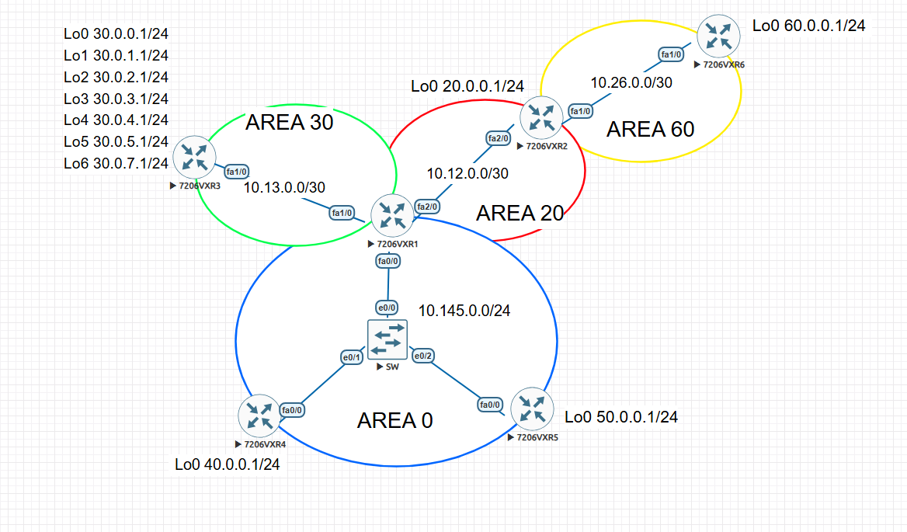
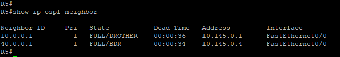
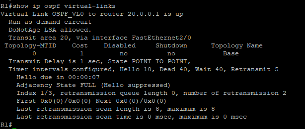
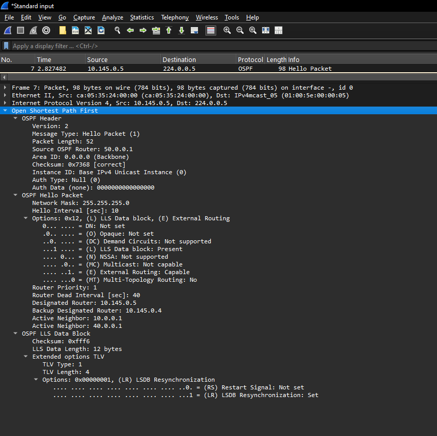
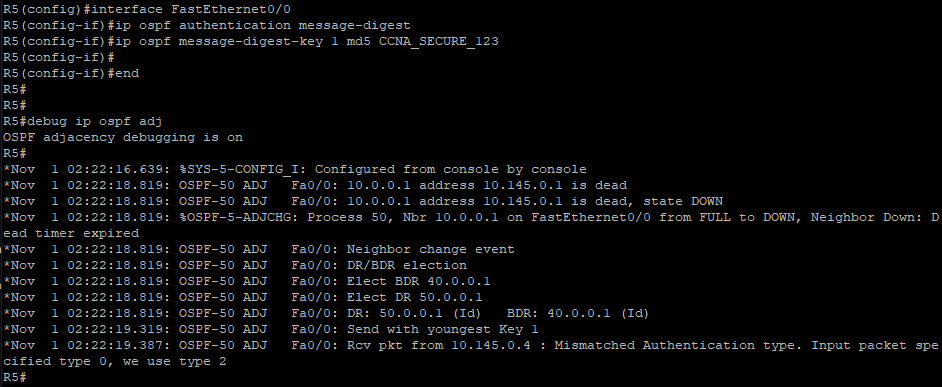
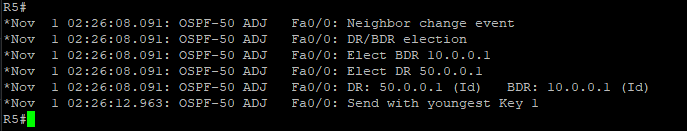
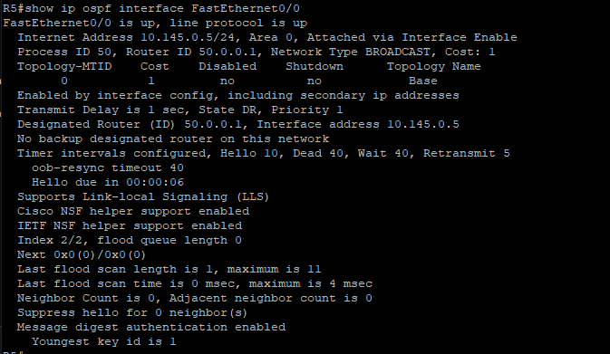

# Multi-Area OSPF Enterprise Network Architecture

## Overview
This laboratory implements an enterprise multi-area OSPF design demonstrating scalable hierarchical routing, backbone area transit, non-backbone area segmentation, and transit path restoration. The topology integrates transit areas, stub area optimization, route summarization, and virtual links across multi-access broadcast segments and simulated edge interfaces. The design addresses practical enterprise network engineering requirements, including Designated Router (DR) and Backup Designated Router (BDR) election dynamics, routing table reduction, and end-to-end multi-area route propagation.

---

## Objectives
* Implement multi-area OSPF across Area 0 (Backbone), Area 20 (Transit), Area 30 (Totally Stubby), and Area 60 (Standard Non-Backbone).
* Configure an OSPF Virtual Link through transit Area 20 to restore Area 60 backbone connectivity.
* Optimize Area 30 routing operations by deploying a Totally Stubby Area (`stub no-summary`) alongside ABR route summarization (`area range`) to minimize routing table overhead and LSA flooding.
* Analyze and validate DR/BDR election behavior and neighbor adjacency states across broadcast multi-access segments.
* Establish deterministic Router ID (RID) assignments across all routing instances to ensure stable topology convergence.
* Verify end-to-end IP reachability, link-state database (LSDB) consistency, and route convergence across all areas.

---

## Topology
The infrastructure is composed of six Cisco 7200 routers interconnected across four functional areas:




* **Area 0 (Backbone Area - Blue Network):** Consists of R1, R4, and R5 connected through an Ethernet switch in the broadcast multi-access subnet `10.145.0.0/24`.
* **Area 20 (Transit Area - Red Network):** Interconnects R1 and R2 via a point-to-point transit link on subnet `10.12.0.0/30`, providing path continuity between the backbone and remote segments.
* **Area 30 (Totally Stubby Area - Green Network):** Connects R1 and R3 over subnet `10.13.0.0/30`, hosting simulated internal user/service networks represented by multiple loopback subnets (`30.0.0.0/24` through `30.0.7.0/24`).
* **Area 60 (Standard Area - Yellow Network):** Connects R2 and R6 over subnet `10.26.0.0/30`, representing a detached departmental segment requiring an OSPF Virtual Link through Area 20 to establish logical connectivity to Area 0.
---

## Network Design
The topology is architected to address core enterprise routing scalability challenges through hierarchical segmentation, boundary optimization, and logical path extension:

* **Hierarchical Segmentation:** Area 0 functions as the core transit backbone, connecting perimeter distribution routers (R1) with internal segments (R4, R5). Non-backbone areas isolate regional and departmental routing information to contain link-state advertisement (LSA) flooding within defined administrative boundaries.
* **Transit Path Extension (Virtual Link):** Because Area 60 does not share a direct physical boundary with Area 0, an OSPF Virtual Link is established across Area 20 between Area Border Routers (ABRs) R1 and R2. This satisfies the fundamental OSPF design rule requiring all non-zero areas to maintain logical adjacency to the backbone.
* **Routing Table Optimization (Totally Stubby Area):** Area 30 is designated as a Totally Stubby Area (`stub no-summary`), suppressing Type 3 (summary) and Type 4/5 (external) LSAs. The ABR (R1) injects a single default route (`0.0.0.0/0`) into Area 30, significantly reducing CPU, memory, and routing table overhead on internal router R3.
* **Inter-Area Route Summarization:** To further protect the backbone from route churn and minimize LSA distribution, R1 performs inter-area summarization using the `area 30 range 30.0.0.0 255.255.248.0` command, aggregating the contiguous loopback prefixes (`30.0.0.0/24` through `30.0.7.0/24`) into a single `/21` advertisement into Area 0.
* **Multi-Access Broadcast Determinism:** The Area 0 Ethernet segment (`10.145.0.0/24`) uses standard OSPF broadcast behavior where DR and BDR elections govern adjacency scaling, while loopback interfaces are configured with point-to-point network types to advertise full `/24` host network masks rather than default host `/32` routes.

---

## Devices and Images
* **Routers:** Cisco 7206VXR (Dynamips / Cisco IOS Software, 7200 Software)
* **Switches:** Cisco IOSvL2 (Virtual Layer 2 Switch Appliance)

---

## OSPF Fundamentals: Single-Area vs Multi-Area

### What is OSPF?
Open Shortest Path First (OSPF) is an open-standard, link-state Interior Gateway Protocol (IGP) defined by RFC 2328. It uses Dijkstra's Shortest Path First (SPF) algorithm to calculate loop-free, shortest-path trees across an IP network. Routers exchange Link-State Advertisements (LSAs) describing their local interfaces, links, and neighbor adjacencies. These LSAs synchronize into a unified Link-State Database (LSDB) on every router within an area, ensuring full topology awareness before computing the routing table.

### Single-Area OSPF
In Single-Area OSPF, all routers and interfaces reside within a single administrative domain—traditionally designated as Area 0 (Backbone Area). 

* **Behavior:** Every router in the area maintains an identical LSDB representing the complete network map.
* **Limitations in Large Topologies:**
  * **Memory Overhead:** As the network grows, the LSDB expands, consuming substantial router memory.
  * **High CPU Utilization:** Any link state change triggers SPF recalculations across every single router in the area.
  * **Large Routing Tables:** Without internal hierarchical boundaries, routers must store individual prefix entries, increasing table size and lookup overhead.
* **Ideal Use Case:** Small to mid-sized networks with simple topologies where routing overhead does not strain hardware resources.

### Multi-Area OSPF
Multi-Area OSPF introduces a two-tier hierarchical design that segments a large autonomous system into smaller, manageable areas connected via a mandatory backbone (Area 0).

* **Architecture and Router Roles:**
  * **Internal Routers:** Routers whose interfaces all belong to the same non-backbone area.
  * **Backbone Routers:** Routers maintaining at least one interface inside Area 0.
  * **Area Border Routers (ABRs):** Routers attached to multiple areas (typically Area 0 and one or more non-backbone areas), maintaining separate LSDBs for each attached area.
  * **Autonomous System Boundary Routers (ASBRs):** Routers that redistribute external routes (e.g., BGP, EIGRP, static) into the OSPF domain.
* **Key Advantages:**
  * **LSDB and LSA Flooding Containment:** Intra-area topology changes are contained within the local area via Type 1 (Router) and Type 2 (Network) LSAs. The ABR abstracts these changes into Type 3 (Summary) LSAs, preventing SPF recalculations from rippling through other areas.
  * **Route Summarization:** ABRs can aggregate multiple contiguous subnets into a single advertisement (`area range`), significantly reducing the size of routing tables across the rest of the network.
  * **Special Area Types:** Allows configuration of Stub, Totally Stubby, and NSSA areas to filter external and summary routes, substituting them with default routes to protect resource-constrained edge routers.
 
---

## Addressing Table

| Device | Interface | IP Address | Subnet Mask | OSPF Area | Description |
| :--- | :--- | :--- | :--- | :--- | :--- |
| **R1** | Fa0/0 | 10.145.0.1 | 255.255.255.0 (/24) | Area 0 | Backbone Multi-Access Segment (BLUE NETWORK) |
| | Fa1/0 | 10.13.0.1 | 255.255.255.252 (/30) | Area 30 | Transit Link to R3 (GREEN NETWORK) |
| | Fa2/0 | 10.12.0.1 | 255.255.255.252 (/30) | Area 20 | Transit Link to R2 (RED NETWORK) |
| | Loopback0 | 10.0.0.1 | 255.255.255.0 (/24) | Area 0 | Router ID / Management Prefix |
| **R2** | Fa2/0 | 10.12.0.2 | 255.255.255.252 (/30) | Area 20 | Transit Link to R1 (RED NETWORK) |
| | Fa1/0 | 10.26.0.1 | 255.255.255.252 (/30) | Area 60 | Transit Link to R6 (YELLOW NETWORK) |
| | Loopback0 | 20.0.0.1 | 255.255.255.0 (/24) | Area 20 | Router ID / Local Prefix |
| **R3** | FA1/0 | 10.13.0.2 | 255.255.255.252 (/30) | Area 30 | Transit Link to R1 (GREEN NETWORK) |
| | Loopback0 | 30.0.0.1 | 255.255.255.0 (/24) | Area 30 | User Network / Simulated Prefix 0 |
| | Loopback1 | 30.0.1.1 | 255.255.255.0 (/24) | Area 30 | User Network / Simulated Prefix 1 |
| | Loopback2 | 30.0.2.1 | 255.255.255.0 (/24) | Area 30 | User Network / Simulated Prefix 2 |
| | Loopback3 | 30.0.3.1 | 255.255.255.0 (/24) | Area 30 | User Network / Simulated Prefix 3 |
| | Loopback4 | 30.0.4.1 | 255.255.255.0 (/24) | Area 30 | User Network / Simulated Prefix 4 |
| | Loopback5 | 30.0.5.1 | 255.255.255.0 (/24) | Area 30 | User Network / Simulated Prefix 5 |
| | Loopback6 | 30.0.6.1 | 255.255.255.0 (/24) | Area 30 | User Network / Simulated Prefix 6 |
| | Loopback7 | 30.0.7.1 | 255.255.255.0 (/24) | Area 30 | User Network / Simulated Prefix 7 |
| **R4** | FastEthernet0/0 | 10.145.0.4 | 255.255.255.0 (/24) | Area 0 | Backbone Multi-Access Segment (BLUE NETWORK) |
| | Loopback0 | 40.0.0.1 | 255.255.255.0 (/24) | Area 0 | Router ID / Local Prefix |
| **R5** | FastEthernet0/0 | 10.145.0.5 | 255.255.255.0 (/24) | Area 0 | Backbone Multi-Access Segment (BLUE NETWORK) |
| | Loopback0 | 50.0.0.1 | 255.255.255.0 (/24) | Area 0 | Router ID / Local Prefix |
| **R6** | FA1/0 | 10.26.0.2 | 255.255.255.252 (/30) | Area 60 | Transit Link to R2 (YELLOW NETWORK) |
| | Loopback0 | 60.0.0.1 | 255.255.255.0 (/24) | Area 60 | Router ID / Local Prefix |

---

## Phase 1: Baseline Implementation

The initial baseline configuration files are modularized by device and stored within the repository's configuration directory. Each configuration provisions the necessary interface addressing, subnet masks, OSPF routing processes, and baseline area memberships:

* [R1 Configuration (R1.cfg)](https://github.com/GiovaniSerra/networking-labs/blob/main/CCNA/advanced/ospf-multi-area/configs/R1.cfg)
* [R2 Configuration (R2.cfg)](https://github.com/GiovaniSerra/networking-labs/blob/main/CCNA/advanced/ospf-multi-area/configs/R2.cfg)
* [R3 Configuration (R3.cfg)](https://github.com/GiovaniSerra/networking-labs/blob/main/CCNA/advanced/ospf-multi-area/configs/R3.cfg)
* [R4 Configuration (R4.cfg)](https://github.com/GiovaniSerra/networking-labs/blob/main/CCNA/advanced/ospf-multi-area/configs/R4.cfg)
* [R5 Configuration (R5.cfg)](https://github.com/GiovaniSerra/networking-labs/blob/main/CCNA/advanced/ospf-multi-area/configs/R5.cgf)
* [R6 Configuration (R6.cfg)](https://github.com/GiovaniSerra/networking-labs/blob/main/CCNA/advanced/ospf-multi-area/configs/R6.cfg)

Full directory path:
* [Repository Configurations Folder](https://github.com/GiovaniSerra/networking-labs/tree/main/CCNA/advanced/ospf-multi-area/configs)

---


## Advanced OSPF Mechanics: Stub Areas & Route Summarization

### OSPF Area Types & Totally Stubby Architecture
Standard OSPF non-backbone areas receive all intra-area (Type 1, Type 2), inter-area (Type 3), and external (Type 5) LSAs. In enterprise edge segments where routers have limited hardware resources or single exit points, flooding every external and inter-area route introduces unnecessary overhead.

* **Stub Area:** Blocks Type 5 External LSAs (and Type 4 ASBR summaries). The ABR injects an inter-area default route (`0.0.0.0/0`) via a Type 3 LSA, while standard Type 3 summary routes from other areas are still permitted.
* **Totally Stubby Area (`stub no-summary`):** A Cisco-proprietary enhancement that blocks both external routes (Type 4/5) and inter-area routes (Type 3). The ABR injects only a single Type 3 default route (`0.0.0.0/0`).
* **Implementation in Topology (Area 30):**
  * Configured with `area 30 stub no-summary` on ABR R1 and `area 30 stub` on internal router R3.
  * Internal router R3 only needs to know about local Area 30 subnets; any traffic destined for Area 0, Area 20, or Area 60 follows the generated default gateway, minimizing the LSDB and memory footprint on R3.

### Inter-Area Route Summarization (`area range`)
OSPF does not support arbitrary summarization within an area; summarization must take place at area boundaries on an Area Border Router (ABR) using the `area <area-id> range` command.

* **Mechanics:** The ABR analyzes all active Type 1 and Type 2 LSAs originating within the source area. Instead of advertising individual Type 3 summary LSAs into the backbone (Area 0) for each individual subnet, it generates a single aggregate Type 3 LSA.
* **Failure Domain Isolation:** If a specific loopback flap occurs in Area 30 (e.g., Lo3 goes down), the summary route remains active as long as at least one component subnet exists. This completely shields Area 0, Area 20, and Area 60 from SPF recalculations and routing churn.
* **Implementation in Topology (R1):**
  * Subnets `30.0.0.0/24` through `30.0.7.0/24` represent 8 contiguous `/24` networks.
  * Summarized at R1 using: `area 30 range 30.0.0.0 255.255.248.0`.
  * The rest of the enterprise network receives a single consolidated `/21` advertisement rather than eight individual routes.


  ---


## Phase 2: Stub Area Optimization & Inter-Area Summarization

### 1. Totally Stubby Area Implementation (Area 30)
In enterprise edge designs, internal routers do not require full visibility into external and inter-area routing tables. Configuring Area 30 as a Totally Stubby Area optimizes hardware resource utilization on R3 by replacing excessive LSA flooding with a single default route.

### Step 1: Stub Configuration on Internal Router R3
When the command is initially applied on R3:

```Plaintext
R3(config)# router ospf 30
R3(config-router)# area 30 stub no-summary
```
Adjacency Failure Analysis: The OSPF neighbor relationship between R1 and R3 drops immediately. During the Hello packet exchange, routers verify the options field (specifically the E-bit flag). Because R3 has the stub flag active and R1 operates in standard mode, an area flag mismatch (stub flag mismatch) occurs, preventing adjacency formation.


### Step 2: Adjacency Restoration on ABR R1
To align parameters and enforce Totally Stubby behavior, the configuration is applied on ABR R1:

```Plaintext
R1(config)# router ospf 10
R1(config-router)# area 30 stub no-summary
```
Outcome: With compatible parameters in the Hello packets, the adjacency immediately re-establishes to the FULL state. ABR R1 now blocks Type 3 (summary) and Type 4/5 (external) LSAs from entering Area 30, injecting only a single Type 3 default route (0.0.0.0/0).

### Step 3: Verification on R3
When verifying the active configurations, neighbor status, and routing table on R3:

The R3 routing table removes all specific inter-area prefixes (O IA), retaining only the directly connected interfaces and the default exit route:


```Plaintext
Gateway of last resort is 10.13.0.1 to network 0.0.0.0

O*IA  0.0.0.0/0 [110/2] via 10.13.0.1, 00:47:56, FastEthernet1/0
```
---

### 2. Inter-Area Route Summarization on ABR R1
R3 advertises eight contiguous /24 networks on its Loopback interfaces (30.0.0.0/24 to 30.0.7.0/24). Without route summarization, ABR R1 forwards eight individual Type 3 LSAs into Area 0, Area 20, and Area 60.

### Baseline: R5 Routing Table Prior to Summarization
Before the summarization configuration on R1, router R5 maintains all eight individual /24 subnets in the routing table:


```Plaintext
     30.0.0.0/24 is subnetted, 8 subnets
O IA    30.0.0.0 [110/3] via 10.145.0.1, 00:00:01, FastEthernet0/0
O IA    30.0.1.0 [110/3] via 10.145.0.1, 00:00:05, FastEthernet0/0
O IA    30.0.2.0 [110/3] via 10.145.0.1, 00:00:05, FastEthernet0/0
O IA    30.0.3.0 [110/3] via 10.145.0.1, 00:00:05, FastEthernet0/0
O IA    30.0.4.0 [110/3] via 10.145.0.1, 00:00:05, FastEthernet0/0
O IA    30.0.5.0 [110/3] via 10.145.0.1, 00:00:05, FastEthernet0/0
O IA    30.0.6.0 [110/3] via 10.145.0.1, 00:00:05, FastEthernet0/0
O IA    30.0.7.0 [110/3] via 10.145.0.1, 00:00:05, FastEthernet0/0
```

### Route Summarization Implementation on R1
To aggregate the eight /24 subnets (reducing the mask by 3 bits, from /24 to /21), inter-area summarization is executed on ABR R1:

```Plaintext
R1(config)# router ospf 10
R1(config-router)# area 30 range 30.0.0.0 255.255.248.0
```

### Verification: R5 Routing Table After Summarization
With the summary route generated by R1, the individual advertisements are suppressed and replaced by a single /21 prefix on all upstream routers:


```Plaintext
     30.0.0.0/21 is subnetted, 1 subnets
O IA    30.0.0.0 [110/3] via 10.145.0.1, 00:50:19, FastEthernet0/0
```

### Technical Benefits:
LSDB and Routing Table Reduction: Consolidates eight route entries into just one in the backbone and remote areas.

Route Flapping Isolation: Instabilities on isolated loopback interfaces in Area 30 do not trigger SPF recalculation or the propagation of new LSAs in Area 0, preserving topology stability.


---

## Phase 3: OSPF DR/BDR Tuning & Network Type Optimization
### 1. Deterministic DR/BDR Election in Area 0
In the Area 0 broadcast multi-access segment (10.145.0.0/24), OSPF elects a Designated Router (DR) and Backup Designated Router (BDR) to minimize adjacency overhead. By default, the election is based on the highest OSPF priority (default is 1), followed by the highest Router ID (RID).

Because OSPF elections are non-preemptive, the router boot sequence often dictates the roles. If R4 boots and initializes OSPF before R5, R4 becomes the DR even though R5 has a higher RID (50.0.0.1 vs 40.0.0.1).

### Implementing OSPF Priority for Predictability
To enforce a deterministic hierarchy regardless of power-on sequence, we manually adjust the OSPF interface priorities:

* R5 (Target DR): Priority 200
* R4 (Target BDR): Priority 100
* R1 (Target DROTHER): Priority 1 (Default)

#### Configuration on R5:

```Plaintext
R5(config)# interface FastEthernet0/0
R5(config-if)# ip ospf priority 200
```

#### Configuration on R4:

```Plaintext
R4(config)# interface FastEthernet0/0
R4(config-if)# ip ospf priority 100
```

#### To force the re-election, the OSPF process must be cleared on the affected routers:

```Plaintext
R1# clear ip ospf process
R4# clear ip ospf process
R5# clear ip ospf process
```
#### Verification
After clearing the OSPF processes and allowing the network to converge, the `show ip ospf neighbor` command on R5 confirms the new hierarchy: R4 is elected as the BDR, R1 becomes a DROTHER, and R5 (the local router) successfully assumes the DR role.




---
## Verification
After convergence, the show ip ospf neighbor command confirms that R5 has successfully assumed the DR role and R4 is the BDR, ensuring predictable topology management.

### 2. Network Type Optimization on Transit Links
By default, Ethernet interfaces operate as OSPF BROADCAST network types. This mechanism forces DR/BDR elections and generates Type 2 (Network) LSAs.

In this topology, the connections between R1-R2, R1-R3, and R2-R6 are /30 direct transit links. Leaving them as broadcast segments adds unnecessary control-plane overhead and delays convergence due to OSPF Wait Timers.

### Optimizing the /30 Interfaces
We configure the OSPF network type to point-to-point on these specific transit interfaces to completely bypass the DR/BDR election.

Configuration applied to the respective FastEthernet interfaces on R1, R2, R3, and R6:

```Plaintext
R1(config)# interface FastEthernet1/0
R1(config-if)# ip ospf network point-to-point
```

### Technical Benefits:
* Faster Convergence: Instantly bypasses the 40-second Wait Timer historically required for DR/BDR elections on broadcast segments.
* LSDB Reduction: Eliminates the generation of Type 2 Network LSAs for the transit subnets, streamlining the link-state database and accelerating SPF calculations.

---

## Phase 4: Virtual Link Configuration
Bridging Detached Areas to the Backbone
A fundamental design rule in multi-area OSPF is that all non-backbone areas must have a direct logical or physical connection to Area 0 (the backbone). In this topology, Area 60 (Standard Area - Yellow Network) is geographically separated from Area 0 by Area 20 (Transit Area - Red Network).

Without intervention, routing information from Area 60 will not be propagated into the backbone, and Area 60 will not receive inter-area routes. To resolve this architectural limitation, an OSPF Virtual Link is established across the transit area (Area 20) to create a logical tunnel between the two Area Border Routers (ABRs).

### Virtual Link Implementation

The virtual link must be configured on both ABRs traversing the transit area. The command syntax requires specifying the transit area ID and the remote neighbor's OSPF Router ID (RID), not its physical IP address.
* Transit Area: Area 20
* R1 Router ID: 10.0.0.1
* R2 Router ID: 20.0.0.1

### Configuration on R1 (Backbone ABR)

```Plaintext
R1(config)# router ospf 10
R1(config-router)# area 20 virtual-link 20.0.0.1
```

### Configuration on R2 (Remote ABR)

```Plaintext
R2(config)# router ospf 20
R2(config-router)# area 20 virtual-link 10.0.0.1
```

### Verification and Validation
Once configured, OSPF establishes a logical point-to-point unnumbered connection between R1 and R2 over Area 20.

#### 1. Verifying Virtual Link Status
Executing the `show ip ospf virtual-links` command on R1 verifies that the adjacency across transit Area 20 to the remote RID 20.0.0.1 is `UP` and functioning as a demand circuit.




### 2. End-to-End Reachability (R5 Routing Table)
With the Virtual Link in the FULL state, R2 becomes an active ABR for Area 0. It injects Area 60 routes into the backbone. Checking the routing table on R5 (an internal Area 0 router) confirms that the Area 60 prefix (60.0.0.0/24) is now successfully learned as an inter-area route (O IA):

```Plaintext
R5# show ip route ospf
     60.0.0.0/24 is subnetted, 1 subnets
O IA    60.0.0.0 [110/4] via 10.145.0.1, 00:05:12, FastEthernet0/0
```

---

## Phase 5: Troubleshooting (TSHOOT) & Case Studies

In real-world enterprise environments, OSPF misconfigurations can lead to routing blackholes, suboptimal paths, or adjacency failures. This section details common issues simulated in this topology, the diagnostic methodology, and the commands used to isolate the root cause.

### Scenario 1: OSPF Network Type Mismatch

**Symptom:** R1 and R3 establish a `FULL` neighbor adjacency, but OSPF routes from R3 do not appear in R1's routing table (and vice-versa).

**Root Cause:** The interface `Fa1/0` on R1 was manually configured as `point-to-point`, while R3 remained at the default `BROADCAST` network type. OSPF successfully forms an adjacency because the Hello/Dead timers match (10/40 seconds by default for both types on FastEthernet). However, the SPF algorithm fails to compute the routes because the link-state database contains conflicting link types for the same segment.

**Diagnostic Steps:**
- `show ip ospf neighbor` reveals an abnormal state where one router sees `FULL/ -` (expecting point-to-point) and the other sees `FULL/DR` (expecting a broadcast election).
- `show ip ospf interface FastEthernet1/0` explicitly reveals the conflicting Network Type on each end.

**Resolution:** Ensure both ends of the `/30` transit link share the exact same network type:

```Plaintext
R3(config)# interface FastEthernet1/0
R3(config-if)# ip ospf network point-to-point
```

---

### Scenario 2: Virtual Link Stuck in DOWN State
*Symptom:* Area 60 routes unexpectedly disappear from the Area 0 backbone. The virtual link is inactive.

*Root Cause:* OSPF virtual links rely strictly on the remote neighbor's Router ID (RID), not its physical interface IP address. If R1 reboots and its RID changes (e.g., if a new Loopback with a higher IP was added without a hardcoded router-id command), R2's virtual link configuration points to a non-existent RID, causing the tunnel to fail.

*Diagnostic Steps:*

* `show ip ospf virtual-links` confirms the state is DOWN.
* `show ip ospf` on R1 verifies the currently active Router ID.

*Resolution:* Always hardcode the Router ID on Area Border Routers (ABRs) to ensure deterministic behavior, and update the virtual link target:

```Plaintext
R1(config)# router ospf 10
R1(config-router)# router-id 10.0.0.1

R2(config)# router ospf 20
R2(config-router)# area 20 virtual-link 10.0.0.1
```

---

### Scenario 3: Adjacency Failure (Stub Flag Mismatch)
*Symptom:* Neighbors transition to the DOWN state. The routers refuse to process incoming Hello packets, and no LSAs are exchanged.

*Root Cause:* Area 30 was configured as a stub area on R3 (area 30 stub), but the configuration was missing on ABR R1. For an OSPF adjacency to form, the Options field (specifically the E-bit, which indicates external routing capability) in the Hello packets must match perfectly.

*Diagnostic Steps:*

* `debug ip ospf hello` provides real-time control plane logs, immediately flagging the error:
* `OSPF: Rcv hello from 30.0.7.1 area 30 from FastEthernet1/0 mismatched Stub/Transit area option bit.`

*Resolution:* Apply the stub configuration consistently across all routers attached to that specific area:

```Plaintext
R1(config)# router ospf 10
R1(config-router)# area 30 stub no-summary
```

---

## Phase 6: Control Plane Analysis (Wireshark)

To validate the OSPF control plane mechanics beyond the Cisco IOS command-line interface, packet captures were analyzed using Wireshark on the Area 0 broadcast segment.

### OSPF Hello Packet Deep-Dive
The following capture inspects an OSPF Hello packet originating from R5 (`10.145.0.5`) destined to the `224.0.0.5` All-OSPF-Routers multicast address.



**Key Control Plane Observations:**
- **Router ID & Area:** The packet correctly identifies the source Router ID as `50.0.0.1` operating within Area `0.0.0.0` (Backbone).
- **DR/BDR Validation:** The `Designated Router` is listed as `10.145.0.5` (R5) and the `Backup Designated Router` as `10.145.0.4` (R4). This independently confirms the deterministic election forced via interface priorities in Phase 3.
- **E-Bit (External Routing Capability):** Within the `Options` field, the `(E) External Routing` flag is explicitly set to `Capable` (`..1.`). This is the exact parameter that causes the "Stub Flag Mismatch" adjacency failure detailed in the Troubleshooting section (Phase 5) when one router expects a standard area (E=1) and the other expects a stub area (E=0).
- **Active Neighbors:** The packet payload acknowledges active bi-directional communication with neighbors `10.0.0.1` (R1) and `40.0.0.1` (R4).


---

## Phase 7: OSPF Security & Control Plane Authentication

### Securing the Backbone Routing Domain
In enterprise networks, leaving routing protocols unauthenticated exposes the infrastructure to route spoofing, traffic misdirection, and Denial of Service (DoS) attacks. To align this routing architecture with cybersecurity best practices, cryptographic authentication is implemented across the Area 0 backbone.

This ensures that R1, R4, and R5 will only accept OSPF Link-State Advertisements (LSAs) from trusted peers possessing the correct pre-shared cryptographic key, effectively securing the control plane.

### Implementation: MD5 Cryptographic Authentication
OSPFv2 supports Null (Type 0), Plaintext (Type 1), and Cryptographic (Type 2) authentication. We implement Type 2 (MD5) on the multi-access backbone segment (`10.145.0.0/24`).

**Configuration applied to R5 (Area 0 Interface):**

```text
R5(config)# interface FastEthernet0/0
R5(config-if)# ip ospf authentication message-digest
R5(config-if)# ip ospf message-digest-key 1 md5 CCNA_SECURE_123
```
(Note: This identical configuration must be deployed on R1's Fa0/0 and R4's Fa0/0 to allow adjacency formation).

### Verification & Adjacency Restoration
When authentication is initially applied to R5 but not yet on R1 and R4, the OSPF Dead timers expire, and the adjacency drops. 



As shown in the `debug ip ospf adj` logs above, the router actively reports mismatched authentication types: `Mismatched Authentication type. Input packet specified type 0, we use type 2`.

`Mismatched Authentication type. Input packet specified type 0, we use type 2.`

Once the keys are synchronized across all Area 0 routers, the adjacencies re-establish and OSPF begins transmitting with the new cryptographic keys:




The security posture can be verified using the interface detail command:



The output confirms that `Message digest authentication enabled` and the `Youngest key id is 1` are actively securing the control plane on the interface.

---

## Acknowledgments & References

This enterprise OSPF architecture, laboratory design, and core documentation structure were adapted and inspired by the technical educational content created by **Gustavo Kalau**.
- **Video Reference:** [CCNA R&S - Curso completo - AULA 18 - LAB OSPF PARTE 01 - AREAS](https://www.youtube.com/watch?v=497neyJPboA&list=PL6BTdBqzl1oYk2XeuD3tqi1SOpLmL3e3L&index=18)

**Official Cisco Documentation:**
- [Cisco OSPF Design Guide](https://www.cisco.com/c/en/us/support/docs/ip/open-shortest-path-first-ospf/7039-1.html): Best practices for OSPF network hierarchical design, area segmentation, and LSDB optimization.
- [Cisco IOS IP Routing: OSPF Command Reference](https://www.cisco.com/c/en/us/td/docs/ios-xml/ios/iproute_ospf/command/iro-cr-book.html): Syntax and operational parameters for advanced commands utilized in this lab, including `stub no-summary`, `area range`, and `virtual-link`.

**IETF Standards (RFCs):**
- **RFC 2328 (OSPF Version 2):** The core standard defining the Shortest Path First (SPF) algorithm, link-state database synchronization, and Designated Router (DR) elections.
- **RFC 3509 (Alternative Implementations of OSPF ABRs):** Defines the strict rules and behavioral expectations for Area Border Routers managing inter-area routing and Virtual Link transit paths.


